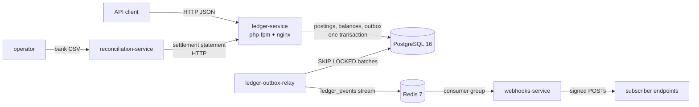

# ledger-platform

A small fintech platform built as a monorepo of three services. At the
centre is a double-entry ledger: every movement of money is a balanced
journal entry, balances are protected by row locks and idempotency keys, and
every change is published as an event. Around it, a webhook service delivers
those events to subscribers, and a reconciliation service checks the bank's
statements against the ledger.

| Service | Stack | What it does | Status |
|---|---|---|---|
| [`ledger-service`](services/ledger-service/README.md) | PHP 8.4, Symfony 8.1, PostgreSQL | accounts, deposits, withdrawals, transfers, statements; transactional outbox to Redis | ✅ stage 1 |
| [`webhooks-service`](services/webhooks-service/README.md) | NestJS, Prisma, Redis streams | signed webhook delivery of ledger events, with retries and a delivery log | ✅ stage 1 |
| `reconciliation-service` | Java 21, Spring Boot 4 | matches bank statement CSVs against the ledger's settlement accounts | 🚧 in review (PR #3) |



Loki and Grafana (on `:3000`) run alongside, with Loki already a Grafana data
source. Nothing ships logs to Loki yet; that needs a collector such as
Grafana Alloy.

## Quickstart

You need Docker with Compose and `make`.

```bash
make up-ledger-service   # postgres, redis, loki, grafana, the ledger API (:8081) and its relay
make install             # PHP dependencies and a local APP_SECRET
make migrate             # schema and one settlement account per currency
make seed                # optional demo accounts
```

Open two accounts and move money. Amounts are decimal strings, and every
money-moving request needs an `Idempotency-Key`:

```bash
API=localhost:8081
ALICE=$(curl -s -XPOST $API/accounts -H 'content-type: application/json' \
  -d '{"name":"Alice","currency":"USD"}' | jq -r .id)
BOB=$(curl -s -XPOST $API/accounts -H 'content-type: application/json' \
  -d '{"name":"Bob","currency":"USD"}' | jq -r .id)

# Deposit 100.00 into Alice's account → 201 Created
curl -s -XPOST $API/accounts/$ALICE/deposits -H 'content-type: application/json' \
  -H "Idempotency-Key: dep-$ALICE" -d '{"amount":"100.00","description":"Salary"}' | jq '{kind, amount, status}'

# Transfer 30.00 to Bob → 201 Created
curl -s -XPOST $API/transfers -H 'content-type: application/json' \
  -H "Idempotency-Key: tr-$ALICE" \
  -d "{\"sourceAccountId\":\"$ALICE\",\"destinationAccountId\":\"$BOB\",\"amount\":\"30.00\",\"description\":\"Dinner\"}" \
  | jq '{kind, amount, status}'

# Send the same transfer again: 200 with Idempotent-Replayed, and no money moves
curl -s -i -XPOST $API/transfers -H 'content-type: application/json' \
  -H "Idempotency-Key: tr-$ALICE" \
  -d "{\"sourceAccountId\":\"$ALICE\",\"destinationAccountId\":\"$BOB\",\"amount\":\"30.00\",\"description\":\"Dinner\"}" \
  | grep -iE '^HTTP|^idempotent-replayed'

# Alice's statement for today: opening 0.00, two lines, closing 70.00
curl -s "$API/accounts/$ALICE/statement?from=$(date -u +%F)&to=$(date -u +%F)" \
  | jq '{openingBalance, closingBalance, lines: [.lines[] | {direction, amount, balanceAfter}]}'
```

What you should see:

- The deposit and the transfer print `"status": "completed"`.
- The replay prints `HTTP/1.1 200 OK` and `Idempotent-Replayed: true`.
- The statement shows a `credit` of 100.00 then a `debit` of 30.00, closing
  at `"70.00"`.
- Asking for more than Alice has (`"amount":"500.00"` with a new key)
  returns a `422` `urn:ledger:problem:insufficient-funds` problem.

Check the books balance with `make verify`, and run the checks with
`make check`.

Each service README covers the rest: [webhooks-service](services/webhooks-service/README.md)
(subscribe a URL and receive these events signed) and the ledger's
[error catalogue, invariants and commands](services/ledger-service/README.md).

## Make targets

| Target | |
|---|---|
| `make up` / `make down` | every service that has a Dockerfile, plus infrastructure |
| `make up-<service>` / `make down-<service>` | one service, e.g. `make up-webhooks-service` |
| `make up-infra` | only postgres, redis, loki and grafana |
| `make check`, `make verify`, `make seed` | ledger-service |
| `make webhook-migrate`, `make webhook-test` | webhooks-service |
| `make help` | everything else |

## Roadmap

- **Stage 2:** holds and two-phase transfers (available vs ledger balance),
  persisted rejected attempts, account product types, OAuth2 for third-party
  channel integrations (Telegram, WhatsApp), and finishing
  `reconciliation-service`.
- **Stage 3:** statement snapshots or PDFs.
- **Not planned yet:** FX and cross-currency transfers, and a FrankenPHP
  runtime experiment.

There is no authentication in stage 1
([ADR 0004](docs/adr/0004-no-auth-in-stage-1.md)); keep the services on a
private network.

## Documentation

- Contracts: [`contracts/openapi/`](contracts/openapi/) (the ledger HTTP API)
  and [`contracts/events/`](contracts/events/) (the event envelopes)
- Architecture decisions: [`docs/adr/`](docs/adr/)
- Design specs and implementation plans: [`docs/superpowers/`](docs/superpowers/)
